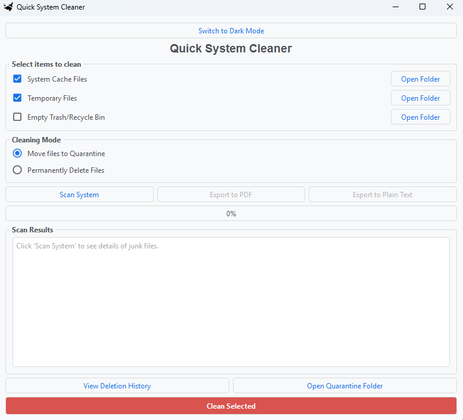

🧹 Quick System Cleaner

A Windows desktop application built with Python and PyQt6 that helps users scan and manage unnecessary system files to free up disk space.

Quick System Cleaner provides a simple graphical interface for scanning temporary files, system cache, and the Windows Recycle Bin. It also offers quarantine and permanent deletion modes, along with cleaning history and report export functionality.

✨ Features
System File Scanner – Scans selected directories for unnecessary files and displays their total size and file count.
Temporary File Cleaner – Scans and cleans Windows temporary files.
System Cache Cleaner – Manages files in the Windows SoftwareDistribution download cache.
Recycle Bin Management – Scans and empties the Windows Recycle Bin.
Quarantine Mode – Moves selected files into a quarantine folder instead of immediately deleting them.
Permanent Deletion – Permanently deletes selected files.
Dark and Light Themes – Switch between dark and light application themes.
Cleaning History – Records file operations in a CSV log.
Export Reports – Export scan results as PDF or plain text.
Disk Space Monitoring – Displays available disk space before and after cleaning.
Folder Navigation – Open the target folders directly from the application.
🛠️ Technologies Used
Python
PyQt6
PyQt6.QtPrintSupport
PyQDarkTheme
CSV
ctypes
pathlib
shutil
os
📸 Screenshots

### Main Window (Dark Mode)
![Main Window] (Screenshots/Main Window.png)

### Light Mode 

### System Scan Results

Screenshots of the application will be added here.

⚙️ Installation

1. Clone the repository

bash
git clone https://github.com/jerichooo1/pyQtdemo.git

2. Navigate to the project directory

bash
cd pyQtdemo

3. Create a virtual environment

bash
python -m venv venv

4. Activate the virtual environment

Windows PowerShell:

powershell
.\venv\Scripts\Activate

5. Install the required dependencies

bash
pip install PyQt6 pyqtdarktheme

▶️ How to Run

Run the Python application:

bash
python main.py

Replace main.py with the actual name of your Python entry-point file if different.

📁 Application Data

The application stores its generated data in the user's home directory:

text
QuickSystemCleaner/
├── Quarantine/
└── Logs/
    └── deletion_history.csv
    
📚 Project Purpose

This project is part of my personal practice and learning journey in Python GUI development using PyQt6.

I developed Quick System Cleaner to gain hands-on experience with building desktop applications, designing user interfaces, handling files and directories, interacting with Windows system features, and implementing application functionality using Python.

This project also helped me improve my understanding of:

PyQt6 widgets, layouts, and signals.
File and directory management.
Python modules and libraries.
CSV logging and report generation.
Basic Windows system operations.

Note: This is a personal practice project created for learning and improving my Python and PyQt6 development skills. It is still open to improvements and future enhancements.

⚠️ Important Notes

Designed specifically for Windows.
Some system directories may require administrator privileges.
Permanent deletion cannot be undone.
Quarantine mode is available as an alternative to permanent deletion.
Review the selected cleaning options before proceeding.

👨‍💻 Author

Jericho Antonio Castillo

GitHub: @jerichooo1

Quick System Cleaner – A Python desktop project for Windows system file management.
